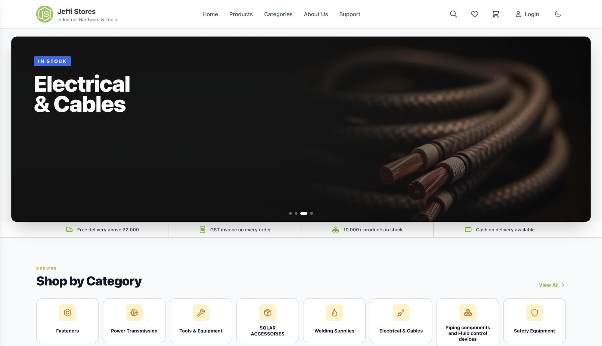

# Jeffi Stores



E-commerce platform powering [jeffistores.in](https://jeffistores.in), an industrial-hardware store,
and the multi-tenant SaaS that runs stores for other merchants. Next.js on AWS, with a full admin
panel, Razorpay payments, GST invoicing and Delhivery shipping.

```bash
npm install
npm run dev     # storefront on :3000, admin at /admin
```

- [Project overview](docs/PROJECT_OVERVIEW.md) — stack, layout, local setup, deployment, environment variables
- [Multi-tenant status](docs/SAAS_MULTITENANT_STATUS.md) — authoritative status for tenants and provisioning
- [Releasing](docs/RELEASING.md)
- [Contributing](CONTRIBUTING.md) · [Security policy](SECURITY.md) · [Code of conduct](CODE_OF_CONDUCT.md)

## License

Copyright (c) 2026 Jeffi Stores. Licensed under the [GNU Affero General Public License v3.0](LICENSE)
(`AGPL-3.0-only`): you may use, modify and redistribute this code, including in production. If you
distribute a modified version, or run one as a service that people use over a network, you must
make its source available to those users under the same license. A commercial license, for use
without those conditions, is available from Jeffi Stores at support@jeffistores.in.
This is the source of a live commercial service and is provided without warranty.
